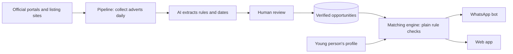

# Architecture

- **AI reads, rules decide.** The LLM only extracts rules from adverts. Eligibility is decided by
  deterministic checks in `backend/app/matching.py`, so every answer has a reason.
- **Adverts are data.** The extraction prompt tells the model to ignore instructions inside adverts,
  and output is validated against the `Rules` model.
- **Scams are blocked.** Any listing that asks for a fee is removed and explained.
